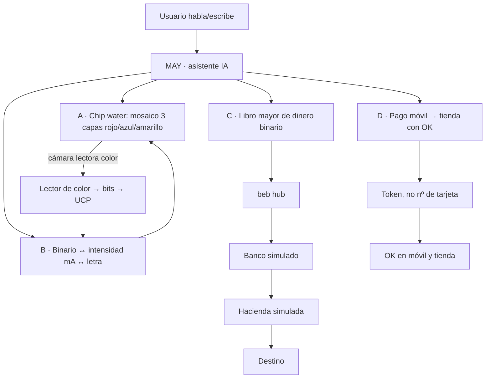

# MAY Core · núcleo binario — documento de diseño (concepto)

**Idea original: Pedro Sánchez Gómez (apuntes a mano).** Organización y propuesta técnica: Grok Bot.
> Todo es **simulación educativa / concepto**. No se conecta a ningún banco real, no usa números de tarjeta reales ni mueve dinero.

## 1. Idea general
Un software con un asistente de IA (**MAY**) al que se le habla en lenguaje natural («codifica HOLA», «pinta el mosaico», «simula la transferencia») y que ejecuta cuatro módulos inspirados en los apuntes.

## 2. Módulos
### (a) Simulador «Chip water» — memoria/pantalla de mosaico de color
- Base con placas de cobre + tapa; cuadrícula de celdas por electrolisis (líquido «negro»/«blanco» = estado 1/0, «como pintura electrónica negra»).
- Tres capas en el orden de la hoja: **rojo = capa 1, azul = capa 2, amarillo = capa 3**. Cada celda de cada capa guarda un bit; el color visible de la celda es la mezcla de capas activas (rojo+azul=morado, etc.) → 3 bits por celda.
- Una **cámara lectora de color** lee cada celda, deduce qué capas están activas y envía los bits a la **UCP**.
- Visión futura de los apuntes: el mismo principio como pantalla táctil de móvil/TV.

### (b) Codificador binario → intensidad → carácter
- Cada bit activo aporta una intensidad de corriente; el chip **suma** las intensidades y el total identifica una tecla del teclado (en la hoja: total 5 mA → letra).
- Las cifras de la hoja (0 / 1 / 1,5 / 2 mA por posición) no son reversibles por sí solas (dos bytes distintos podrían dar el mismo total). El prototipo propone pesos **0,5 · 2^posición mA**, de modo que cada total corresponde a una sola letra, y lo deja configurable para probar los pesos originales.

### (c) Libro mayor de «dinero solo binario»
- Orígenes 1–4 (5 000, 500, 1 000, 20 000) → hub **beb** («bussines enterprise bank», en nube tipo Azure) → banco (Sabadell) → Hacienda → destino (Pedro Sánchez).
- Cada movimiento es un registro binario con huella (hash) encadenada, como un libro mayor verificable. Se muestran los totales (26 500; la hoja anota 2 650) y una retención de Hacienda **ficticia** configurable.
- Portal personalizado (subdirectorio por usuario, «Portal/usuario Pedro») visto desde un PC de oficina: en el prototipo, un resumen por usuario.

### (d) Pago móvil → tienda por wifi (adiós a la tarjeta física)
- El móvil y el receptor de la tienda muestran los mismos datos (titular, banco, importe 90 €) y ambos confirman con **OK**.
- Cómo se hace de forma segura en el mundo real (dicho llano):
  - **Tokenización**: el móvil nunca envía el número real de la tarjeta, sino un «token» sustituto que sólo vale para ese dispositivo/comercio.
  - **EMV** (estándar de chip y contactless/NFC): cada pago lleva un criptograma único que no se puede reutilizar.
  - **PSD2 / autenticación reforzada (SCA)**: en la UE hay que confirmar con dos de tres cosas: algo que sabes (PIN), algo que tienes (el móvil) y algo que eres (huella/cara).
  - NFC a centímetros es más seguro que wifi abierto; la tienda sólo ve los últimos 4 dígitos.

## 3. MAY encima de todo
MAY interpreta la orden, elige el módulo, lo ejecuta y explica el resultado en voz/texto. Ejemplos: «MAY, escribe OSNEWS en el chip» → (b) + (a) y PNG del mosaico; «MAY, ¿cuánto llega a destino?» → (c); «MAY, simula pagar 90 € en la tienda» → (d) con OK.

## 4. Próximos pasos
Prototipo en `prototipo.py`; luego interfaz de chat, lector de cámara real sobre el PNG, y pruebas con los pesos de corriente originales de Pedro.
